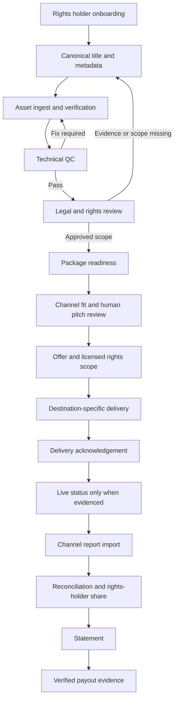

# Filmhub Operating Model Research and Crayons Bridge Translation

**Status:** Research-backed implementation specification; draft for review  
**Date:** 2026-10-16  
**Canonical repository:** `picturecrayons-cyber/Media-Factory`  
**Scope:** Product/technology, infrastructure, backend logic, business model, sales, and end-to-end operating workflows  
**Safety boundary:** This document does not authorize Production deployment, production data/schema/secret changes, real payments, licensing/publication grants, or production storage writes.

## Executive summary

The useful lesson from Filmhub is the integrated operating model: title intake and quality control, human-led channel pitching and licensing, destination-specific media delivery, channel-level status tracking, delayed performance reports, accounting reconciliation, statements, and payout. Its dashboard is the visible surface of these linked operations—not the entire product.

Crayons Bridge should implement and operate a similar *class* of business workflow, using its own domain model, agreements, partner relationships and existing architecture. Do not copy proprietary code, assets, branding or undocumented internals. Reuse existing Bridge capabilities before creating new ones.

## Evidence rules

Every assertion belongs to one of these categories:
- **Publicly documented:** supported by a cited Filmhub public source.
- **Observed from the supplied dashboard:** visible in the user-provided snapshot, but not independently verified against Filmhub live data.
- **Bridge repository evidence:** described in existing Bridge implementation or release documents; runtime certification may still be missing.
- **Design proposal:** recommended behavior for Bridge, not a claim about Filmhub.
- **Unknown:** not established by current available evidence.

Public sources and observations reviewed on 2026-10-16. Prices and programme terms are time-sensitive; re-verify immediately before any commercial use. Public job advertisements and changelog entries are clues, not proof of the full running production stack.

## 1. Product modules and user roles

### Filmhub-facing modules observed/documented
- Home: estimated earnings, channels and titles ranked by estimates, licensing activity.
- My Titles: title inventory/submission.
- Updates: operational changes.
- Channels: distribution destinations.
- Insights / Performance: channel- and title-level reporting.
- Statements: statement and payment visibility.
- Schedule: delivery/release calendar.
- Plans, referrals, support and changelog.
- Public Help Center describes QC, acquisition/sales review, delivery, earnings reporting and payment workflows.

The supplied dashboard snapshot shows a six-month gross-estimate figure of **$49.144** (likely display formatting for approximately $49.14), with Amazon Prime Video, Rapido, Hoopla, Plex and WOCOO among listed channels; the top title is *Jananam: 1947 Pranayam Thudarunnu*. These are user-supplied screen figures, not audited cash or a verified statement. Statuses include Licensed and Removed, illustrating why status history needs dates and destination scope.

### Bridge product roles and boundary
- Creator / Studio: upload and manage their own title workspace, inspect workflow state, respond to QC/legal requirements and see rights/revenue data they are authorized to see.
- Buyer / Licensing: view buyer-safe discovery and rights availability, request materials/offers, negotiate and license within authorized scopes.
- Admin / QC / Legal / Distribution / Finance: perform separated duties; privileged actions are server-authorized and audited.
- Investor: access only explicitly authorized investment and reporting records.
- Crayons Bridge is the canonical B2B control plane/title authority; Crayons Loop is the consumer catalog/playback runtime. Loop must only receive approved publication/delivery state.
- Existing approved Supabase project and immutable Bridge title UUID are canonical. Do not create a second app, Vercel project, Supabase project, title authority or parallel analytics store.

Sources:
- Supplied Filmhub dashboard snapshot (user-provided; observation only).
- Bridge scope: https://github.com/picturecrayons-cyber/Media-Factory/blob/main/docs/bridge-prd-implementation-scope.md
- Bridge product guardrails: https://github.com/picturecrayons-cyber/Media-Factory/blob/main/docs/product-design-guardrails.md
- Architecture contract: https://github.com/picturecrayons-cyber/Media-Factory/blob/main/docs/production-architecture-lock.md

## 2. Filmhub process as a business workflow

Filmhub's own public Help Center describes a process in which titles are submitted and reviewed, sales/acquisitions may pitch titles to suitable channels, a channel makes its licensing decision, delivery is prepared for the destination, channel release occurs later, and reporting/payment arrive according to channel-specific cycles. A visible license record does not itself prove that a title is live.

Sources:
- https://help.filmhub.com/articles/2823375-how-filmhub-diz-7-steps
- https://help.filmhub.com/en/articles/2663785-how-filmhub-sells-your-movies-shows
- https://help.filmhub.com/how-to-submit-your-title-to-qc
- https://help.filmhub.com/what-is-quality-control-qc
- https://help.filmhub.com/understanding-reports-and-earnings

### Bridge workflow (proposed)

Every stage must have explicit preconditions, actor, record mutations, event/audit entry, notification, timeout/failure path, retry strategy and completion evidence. Do not let one title-level status imply every destination or rights scope has the same state.

## 3. Technology and infrastructure

### Public evidence
1. Filmhub describes QC checks across video, audio, captions, artwork and metadata; a later delivery may still require additional destination-specific requirements.
   - https://help.filmhub.com/what-is-quality-control-qc
2. Public transfer guidance mentions multiple transfer mechanisms, including S3, SFTP/FTP/FTPS and Aspera. This establishes destination variability, not its entire internal storage design.
   - https://help.filmhub.com/en/articles/2692190-setting-up-file-transfer
3. A public changelog describes streaming media into transcode workers rather than first downloading the whole source to temporary local storage. It is evidence for one optimization, not the complete transcoding architecture.
   - https://headwayapp.co/filmhub-changelog/streaming-transcodes-282709
4. A public engineering job listing mentions React/Next.js, PostgreSQL, AWS services and FFmpeg. Hiring material is secondary evidence and does not prove all listed technologies are deployed in production.
   - https://startup.jobs/lead-product-engineer-filmhub-6236041

### What remains unknown
The material reviewed does not prove Filmhub's complete cloud topology, storage vendor for all internal data, database schema, queue/event infrastructure, API topology, transcoding fleet, security controls or ledger implementation. Treat these as unknown until credible public engineering sources establish them.

### Bridge infrastructure recommendation
- Keep OCI Object Storage (Mumbai) as canonical production media storage and use the existing Vercel/Supabase setup.
- Use provider adapters for external partner transfer protocols; partner credential material remains server-side and secret-managed.
- Media workloads should be asynchronous and bounded: upload verification, QC jobs, transcode/package jobs, transfer attempts and reconciliation should not rely on long-running browser or web requests.
- For each job persist a safe state record: job ID, canonical title UUID, asset version, destination, idempotency key, attempt number, started/updated timestamps, bounded error code, safe message, provider request reference, retry eligibility and completion evidence.
- Do not add a transcoding worker or new queue solely because Filmhub may have one. First measure Bridge throughput, latency, memory/disk usage, retry pain and expected cost; select the simplest architecture that meets measured requirements.
- Upload/transfer success needs evidence that bytes were written, the expected object/asset mapping exists, and a read-back or destination acknowledgement succeeded. Configuration presence or green build alone is not E2E certification.
- Keep source masters, signed object URLs, contracts, legal evidence and partner credentials out of public/buyer projections.

Bridge sources:
- https://github.com/picturecrayons-cyber/Media-Factory/blob/main/docs/release-readiness.md
- https://github.com/picturecrayons-cyber/Media-Factory/blob/main/docs/operational-loop-mvp-20261004.md
- https://github.com/picturecrayons-cyber/Media-Factory/blob/main/docs/production-architecture-lock.md

## 4. Backend domain model and state machines

Treat this section as a target data contract. Map every entity to the actual existing Bridge tables/services before any schema change; do not assume these names already exist.

### Proposed logical records
- **Title**: immutable Bridge UUID, owner/workspace custodian, metadata revision, current lifecycle and timestamps.
- **Asset version**: title UUID, asset UUID, version, asset kind, object reference, checksum/size/media metadata, verification state, source/master/derivative relationship.
- **QC run/result**: scope/profile and profile version, checked asset versions, tool/reviewer, findings, result, reviewed time, rejection reason.
- **Legal review**: reviewed evidence references, authority checks, reviewer, decision, scope and validity window. An uploaded document is not automatic proof of rights.
- **Rights grant/availability**: title UUID, rights category, territories, languages, platform/media modes, start/end and timezone, exclusivity, holdbacks, sublicensing, allowed promotional uses, evidence and approval.
- **Destination/partner profile**: approved partner identity, delivery protocol profile, required metadata/assets, territory/content policy, credential reference (not credential), active/disabled state.
- **Title-destination deal/pitch**: title UUID, destination UUID, rights scope/version, proposed terms, pitch stage, human owner, next follow-up, decision and source evidence.
- **Delivery package/attempt**: package version, manifest, target profile version, source asset versions, checksum, attempt state, provider reference, acknowledgement and safe failure state.
- **Channel status event**: destination, title UUID, rights scope, status transition, event source, external reference, observed_at, received_at, evidence class, actor and immutable audit reference.
- **Usage/revenue record**: source report/batch, destination, report period, original currency/amount/metric, normalized values, source hash and import idempotency key.
- **Adjustment**: reason category, source evidence, amount/currency, report/transaction linkage, approval and reversal linkage.
- **License/contract snapshot**: immutable approved terms revision and private document reference, accepted deal, signatories and effective dates.
- **Statement/statement line**: statement period/version, included revenue/adjustments/fees/tax/FX calculations, governing deal/rights scope, rights-holder payable, computation version and audit trail.
- **Settlement/payout evidence**: provider transaction/reference, amount/currency/date, matched statement lines, verification status and reconciliation result.
- **Audit event**: actor, role, action, target ID, before/after hashes or safe field diff, correlation ID, event time and outcome.

### Delivery/channel lifecycle
Do not compress all of these into a single title status. Suggested destination-scoped lifecycle:

`CANDIDATE → READY_FOR_QC → QC_PASSED → RIGHTS_CLEARED → PITCH_READY → PITCHED → OFFERED → LICENSED → DELIVERY_QUEUED → DELIVERING → DELIVERED → ACKNOWLEDGED → LIVE_CONFIRMED → REPORTING_ACTIVE`

Allowed side/terminal outcomes include `FIX_REQUIRED`, `REJECTED`, `OFFER_DECLINED`, `DELIVERY_FAILED`, `SUSPENDED`, `REMOVAL_REQUESTED`, `REMOVED_CONFIRMED`, `EXPIRED`, and `REVOKED`. A state transition must be allowed only by a server-side service with permission checks and explicit evidence. `LIVE_CONFIRMED` requires destination/platform evidence; `LICENSED` does not automatically imply `DELIVERED` or `LIVE_CONFIRMED`.

### Financial lifecycle
Keep independent financial facts rather than using one status:
- `ESTIMATED`: preliminary projection/report; not cash or final accounting.
- `REPORTED`: source channel statement/report exists.
- `RECONCILIATION_PENDING`: evidence incomplete or conflicting.
- `RECONCILED`: amount and terms matched to source evidence.
- `RECEIVABLE_RECORDED`: amount owed to Bridge under approved terms.
- `CASH_RECEIVED_VERIFIED`: receipt matched to a verified transaction/bank/provider record.
- `RIGHTSHOLDER_PAYABLE`: contractual share calculated from the reconciled base.
- `PAYOUT_INITIATED`: transfer request recorded, not yet proof of success.
- `PAID_CONFIRMED`: provider/bank evidence matches transfer.
- `DISPUTED` / `REVERSED` / `UNRECONCILED`: exception states.
   
Store original amount/currency and report period; preserve FX rate/source/date, deductions, refunds, taxes, channel/processor fees and rounding rules. Every displayed aggregate should be drillable to immutable source rows. Prevent duplicates with a provider/event/batch idempotency key and unique constraint. Do not backfill missing reported revenue using current rental or asking prices.

## 5. API/service logic and reliability rules

Proposed service boundaries (names conceptual; map against repository before coding):
1. `titleService`: create/update canonical title; validate workspace/role.
2. `assetService`: create upload intent, validate metadata/checksum, confirm provider object and read-back.
3. `qcService`: run profile preflight, record review result against exact asset versions.
4. `rightsService`: create/review evidence and scope; deny buyer availability while pending.
5. `channelMatchService`: calculate explainable fit signals without issuing external promises; operator approves pitches.
6. `licensingService`: store immutable approved deal terms; prohibit self-approval where separation of duties is required.
7. `deliveryService`: create versioned package, dispatch asynchronously, record provider acknowledgement/retry attempts.
8. `channelEventService`: idempotently ingest external statuses and keep raw source reference.
9. `revenueImportService`: preserve raw report artifact, normalize records, reject duplicates, raise exceptions for mapping/conflict.
10. `reconciliationService`: match report → deal/rights scope → received funds → holder share → statement → payout.
11. `statementService`: immutable statement version, secure export, dispute and corrected-statement flow.
12. `auditService`: append durable events in the same transaction as sensitive state changes where possible.

Reliability invariants:
- Every external callback/import verifies its origin/signature or follows a documented authenticated manual-import process.
- Retries reuse idempotency keys; repeat calls never create duplicate delivery, payments, earnings or entitlement records.
- State changes and audit event writes are transactional or have a recoverable outbox strategy.
- Unknown/out-of-order events are stored and quarantined rather than silently ignored.
- On a timeout, use bounded exponential backoff with jitter and a maximum-attempt policy; then create an operator-visible exception.
- Do not log credentials, unbounded provider response bodies, contract contents or signed URL secrets.
- Fail closed when rights evidence, QC, deal scope, destination eligibility or permission checks are unresolved.
- Track the evidence timestamp and the period to which the data applies; a recent UI refresh must not hide a stale partner report.

## 6. Business model and unit economics

### Filmhub public evidence reviewed (re-check before business decisions)
- Filmhub's revenue share article describes an 80% producer / 20% Filmhub split on amounts it receives from channels.
  https://help.filmhub.com/en/articles/2663772-filmhub-revenue-share
- The public plans page reviewed lists Free, Basic ($499/year), Premium ($999/year), and Premium Plus ($1,999/year); plan features include varying service/QC/analytics/support/acquisition capabilities. Availability, naming and pricing can change.
  https://help.filmhub.com/plans
- Public professional-service examples include artwork, captions/subtitles, video fixes, marketing and title services.
  https://help.filmhub.com/professional-services
- A public referral page describes 10% of Filmhub's revenue share for up to five years for a qualifying referred customer; verify current terms and eligibility before comparing.
  https://help.filmhub.com/referral-program

These describe one competitor's public positioning, not an automatic price card for Bridge.

### Bridge revenue hypotheses to validate
1. Entry tier for title registration and limited readiness assessment.
2. Subscription for studio-scale collaboration, storage allowance, QC workflow and operational reporting.
3. Transparent paid services: asset repair/conformance, artwork/caption preparation, metadata cleanup, deliverable packaging and assisted onboarding.
4. Premium support/analytics/acquisitions assistance for a clearly described service commitment.
5. Deal/commission fees only under explicit contracts and clear definition of the revenue base.
6. Rights marketplace/transaction revenue only after scoped rights, counterparty acceptance, payment and entitlement paths are demonstrably reliable.

Avoid charging for the mere appearance of channel distribution or implying guaranteed licensing. Separate self-service software from optional managed services.

### Unit economics formula
For each title, studio cohort and channel:
- Net channel receipts = reported gross in source currency - source-backed refunds/chargebacks/adjustments - fees included at that accounting layer; convert only with a recorded FX basis.
- Bridge take = contractually defined Bridge share × the explicitly defined eligible base.
- Rights-holder payable = eligible reconciled amount × approved contractual share, less only authorized deductions/withholdings.
- Contribution margin = Bridge revenue (subscription allocation + service margin + contractual transaction income) - incremental storage/egress/transcode/QC/delivery/support/payment/tax costs.
- Track lifetime margin per title, cost per submitted/approved/delivered title, time-to-QC, QC revision rate, delivery success rate, channel acceptance per pitch, time-to-report, report aging, reconciliation exception rate, payout error rate, logo/service attach rate, referrals-to-paid conversion and customer retention.

No margin model should use invented distribution volume or unverified partner payment rates. Populate a workbook with actual measured costs and cohort data before setting prices.

## 7. Sales and partner strategy

### Rights-holder acquisition funnel
`Lead → Qualified rights holder → Catalogue/authority check → Title readiness review → Pilot/onboarding → QC/legal ready → Channel-fit review → Pitch/offer → License/delivery → First evidenced report → Reconciled statement → Renewal/expansion/referral`

Each lead should have a source, segment, catalogue count, rights authority confidence, decision maker, territory/language scope, title readiness, expected next action/date, blocker, deal value range (clearly marked estimated), owner and outcome. Do not treat a lead, pitch, verbal interest or delivered screener as a licensed deal.

### Segment-specific methods
- Independent producers: focused readiness audit, clear requirements, assistance options, transparent rights control and reporting.
- Studios/catalogue owners: batch import, catalogue normalization, role-based collaboration, bulk readiness and cohort reporting.
- Distributors/aggregators: rights provenance, territory conflict checks, contractual chain and scoped authority.
- OTT/broadcasters/buyers: curated buyer-safe catalogue, accurate metadata, private screening, explicit rights availability, offer tracking and delivery profiles.
- Education/transactional/specialty channels: scope and term filters, accessibility assets, price/fee model and reporting requirements appropriate to the deal.
- Channel/platform partners: documented technical profile, test package, security/credential handling, delivery SLA, escalation contact, report cadence and reconciliation process.

### Pitch-package minimum
Approved logline/synopsis; genre/tags; runtime and format; languages/audio/captions; cast/crew; rights-holder authority evidence; available territories and media rights; start/end dates and restrictions; approved artwork and trailer; QC/delivery readiness; known comparable audience/marketing proof with sources; commercial ask/terms range; private screener policy; contact and follow-up date.

### Sales operating cadence (hypothesis)
- First response: confirm catalogue fit and rights authority.
- Readiness call: identify asset/legal blockers and buyer scope.
- Curated package: send only approved material appropriate to recipient permission.
- Follow-up: record outcome and next date; avoid unbounded or automated spam.
- Closed-loop feedback: record pass/reject reason, channel requirements and lessons for the next pitch.
- Review weekly: qualified catalogues, readiness conversion, pitch count, buyer response, offers, licenses, delivery success, report aging, reconciled revenue and renewals.

Do not state a buyer or platform relationship as active unless current agreement or authoritative evidence verifies it.

## 8. End-to-end workflow playbooks

For all flows: the trigger, authenticated actor, preconditions, write set, audit event, customer notification, failure state, retry policy and evidence of completion must be specified.

### A. Onboarding and title submission
1. Creator/studio signs in; verified workspace ownership/role.
2. Create or select canonical title UUID; duplicate detection by title identity is advisory and must not silently merge records.
3. Capture metadata, assets, title ownership/authority and intended rights.
4. Show completion rail and blockers; save drafts safely.
5. Notify user of incomplete required fields. No title can be buyer-visible on the basis of draft metadata alone.

### B. Asset upload and technical QC
1. Create a short-lived signed upload intent using server-controlled path.
2. Upload to OCI; verify object existence, size and checksum/read-back and match to asset UUID/title UUID.
3. Create immutable asset version; set state only from confirmed evidence.
4. Run technical preflight against a versioned QC profile.
5. Reviewer records findings against that exact version; replacing an asset invalidates stale approvals for the affected deliverable.
6. On failure, show actionable safe error and retry/fix route. Do not mark verified solely because an upload request returned 2xx.

### C. Legal and rights review
1. Capture rights category, territory, language, platform/mode, term, exclusivity, holdbacks and permitted uses.
2. Store private evidence references; separate uploader assertions from reviewer approval.
3. Require authorized reviewer and, where configured, separate approver.
4. Pending/rejected/expired/conflicted scopes cannot enter buyer-available projections.
5. Record conflicts and review decisions immutably.

### D. Buyer/destination matching and pitch
1. Filter candidate destinations by approved scope, content/technical profile and current partner requirements.
2. Show explainable fit and missing data to authorized operator.
3. Human approves pitch and permitted screener/package access.
4. Save pitch and follow-up events with date, operator and response evidence.
5. A pitch is not an offer acceptance; an offer is not a license until required terms/approvals are completed.

### E. Licensing and deal creation
1. Record title UUID and exact licensed scope; include territory/language/media, start/end, exclusivity, revenue base/share, currency, reporting and payment provisions.
2. Snapshot negotiated terms and approved contract reference.
3. Separate required approvals and deny self-approval where specified.
4. Create scoped entitlement only from approved deal and any required verified payment event.
5. A single deal never changes unrelated title rights to globally licensed.

### F. Package and deliver
1. Resolve immutable package manifest against destination profile version and approved asset versions.
2. Validate rights window and content restrictions at dispatch time, not only at pitch time.
3. Dispatch as bounded asynchronous job, persist attempt and provider reference.
4. Retry transient errors idempotently; quarantine permanent/specification/credential errors.
5. Confirm destination acknowledgement; only use LIVE_CONFIRMED after a separate valid platform/status signal.
6. Revocation/removal creates an auditable request and remains pending until external completion is evidenced.

### G. Channel status updates
1. Accept authenticated webhook/API/import or documented manual evidence.
2. Preserve raw event source/hash and external IDs with receive/observed times.
3. Deduplicate, order, validate current scope and apply allowed state transitions.
4. Keep per-destination status, status history and report freshness visible.
5. Unknown or contradictory signals go to an exception queue instead of replacing canonical state.

### H. Revenue import and reconciliation
1. Import raw report artifact with checksum, channel, report range, source currency and source metric.
2. Normalize with a versioned mapping; preserve the raw source to support future reprocessing.
3. Deduplicate by provider batch/record identity; quarantine malformed, conflicting or out-of-scope records.
4. Match relevant licensed scope and deal terms in force during the revenue period.
5. Separately record estimates, finalized report amounts, adjustments, FX, channel cash receipt, Bridge fee/share and rights-holder payable.
6. Reconcile with channel settlement/provider/bank evidence; unmatched balances remain pending.
7. Notify finance about stale reports and create bounded exceptions.

### I. Statements and payout
1. Generate a versioned statement only from defined source records and a reproducible calculation version.
2. Make every line traceable to report and deal/rights scope; state whether amounts are estimated, finalized, receivable or payable.
3. Export CSV/PDF with private access checks; protect spreadsheet exports from formula injection.
4. Corrections create a new version and linked adjustments, not silent overwrites.
5. A payout initiated status is not paid-confirmed. Set paid-confirmed only when provider/bank transaction evidence matches amount, currency, recipient and transfer identity.
6. Disputes pause only the relevant amount/line where contract and controls allow, with full audit evidence.

### J. Renewal, expiry and incident
1. Schedule warnings before a deal/right window expires.
2. Re-evaluate active deliveries/publication against rights and destination restrictions.
3. Expiry/revoke suspends future authorization immediately within Bridge control; external takedown remains pending until acknowledged.
4. Preserve historical license/report/payment data and avoid deleting necessary audit records.
5. Record incident timeline, affected titles/destinations, operator, mitigations and evidence of restoration.

## 9. Suggested parity and readiness matrix

| Capability | Filmhub evidence | Bridge existing evidence | Next step / acceptance test |
|---|---|---|---|
| Title intake and workspace | Public title submission/QC docs | Canonical Title Workspace documented | Compare current routes and required asset groups; test role/owner isolation |
| QC/legal separation | Public QC workflow | Bridge docs explicitly require separate QC and legal approval | Verify against exact current code and tests; prove replacement asset invalidates stale approval |
| Destination-specific distribution | Public multi-method transfer docs | Distribution authorization and Loop path documented; external partner E2E remains incomplete | Map real partner profiles; Preview package/transfer/acknowledgement test |
| Licensing status | Dashboard snapshot; public licensing process | Rights/deal/publication workflows partly documented and draft work tracked | Store per-destination/scope state events, source evidence and safe transitions |
| Performance and revenue | Dashboard estimates, channel reports, statements | Receipt/producer-share logic exists in limited scope; docs warn it is not full-period accounting | Identify actual canonical tables/services; run fixture-based import/reconciliation tests |
| Statements/payout | Public reports/payments guidance | External settlement references explicitly unverified in existing Bridge docs | Statement fixture with adjustments/FX, source drill-down, verified payout-match tests |
| Sales operations | Public channel sales guidelines | Buyer/distribution controls under active development | Pitch packet + human queue + pipeline stage/next action; no fictional partner states |
| Referral/services | Public plan/services/referral pages | Business idea only until assessed | Pilot willingness-to-pay and unit economics before implementing billing changes |

## 10. Prioritized execution plan

### P0 — release reliability and evidence quality
- Keep current Production Stability Lock and release HOLD.
- Resolve existing OCI upload/copy verification blockers; perform only isolated non-production E2E with least-privilege, dedicated resources.
- Verify source-to-deployed exact SHA, existing CI gates, auth/role isolation, audit/RLS and payment webhook correctness.
- Complete real role-based Preview workflows required by the existing release documentation.
- Stop claims of production readiness where test evidence does not exist.

### P1 — revenue-enabling operational slice
- Map actual current routes, services, tables and open PRs; do not duplicate existing capability.
- Close a single vertical slice for a safe non-production title: title + versioned assets → QC/legal/right gates → destination pitch/deal → package/delivery record → status event → source report import → statement calculation → settlement reconciliation.
- Build an owner/operator exception queue and trace every dashboard number back to evidence.
- Add channel-fit/pitch stages and partner profile versioning with human review.

### P2 — scale after proof
- Multi-destination adapters and delivery SLA dashboards.
- Async processing workers only after measured throughput/cost warrants them.
- Automated report ingestion and source normalization with operator exception handling.
- Referral programmes, analytics tiers, service attach, catalogue-scale tools and advanced revenue waterfalls after pricing/unit economics validation.

## 11. Acceptance criteria for implementation PRs

A proposed code change is ready to review only when:
- It maps to the current canonical implementation and avoids duplicate modules.
- It changes no production data, credentials, infrastructure or live grants.
- It includes server-side auth and resource scoping; buyer/public projections exclude masters, contracts and private evidence.
- It has unit/integration tests for positive flow, negative permission case, duplicate/retry, out-of-order/conflicting input and rollback/error paths as appropriate.
- Exact-head CI passes, matching Vercel Preview SHA is confirmed, and authenticated role-based E2E evidence is recorded.
- No estimates are labeled received/paid, no licensing/live claims are fabricated, and unresolved external work stays visibly pending.
- Reviewed merge and later production promotion happen only after all independent release gates pass.

## Appendix A — Source list

Official Filmhub:
- Seven steps: https://help.filmhub.com/articles/2823375-how-filmhub-diz-7-steps
- Sales/pitching: https://help.filmhub.com/en/articles/2663785-how-filmhub-sells-your-movies-shows
- QC: https://help.filmhub.com/what-is-quality-control-qc
- Submit to QC: https://help.filmhub.com/how-to-submit-your-title-to-qc
- Catalog specs: https://help.filmhub.com/catalog-import-specs
- Transfer setup: https://help.filmhub.com/en/articles/2692190-setting-up-file-transfer
- Earnings/reporting: https://help.filmhub.com/understanding-reports-and-earnings
- Revenue share: https://help.filmhub.com/en/articles/2663772-filmhub-revenue-share
- Plans: https://help.filmhub.com/plans
- Professional services: https://help.filmhub.com/professional-services
- Channel block/removal: https://help.filmhub.com/en/articles/2621288-blocking-channels
- Referral programme: https://help.filmhub.com/referral-program
- Transcode optimization changelog: https://headwayapp.co/filmhub-changelog/streaming-transcodes-282709
- Secondary engineering job listing: https://startup.jobs/lead-product-engineer-filmhub-6236041

Canonical Bridge documents reviewed:
- https://github.com/picturecrayons-cyber/Media-Factory/blob/main/docs/bridge-prd-implementation-scope.md
- https://github.com/picturecrayons-cyber/Media-Factory/blob/main/docs/release-readiness.md
- https://github.com/picturecrayons-cyber/Media-Factory/blob/main/docs/operational-loop-mvp-20261004.md
- https://github.com/picturecrayons-cyber/Media-Factory/blob/main/docs/production-architecture-lock.md
- https://github.com/picturecrayons-cyber/Media-Factory/blob/main/docs/product-design-guardrails.md

## Appendix B — Explicit assumptions and unknowns
- The user-provided estimate figure is not reconciled accounting evidence.
- Public help pages may be revised; plan pricing/programme terms require a fresh re-check before use.
- Public hiring and changelog material cannot prove the complete production architecture.
- Partner channel relationships, APIs, accepted delivery modes and commercial terms must be verified per real partner/contract.
- This is a specification and workflow design change, not a database migration or executable runtime implementation.
